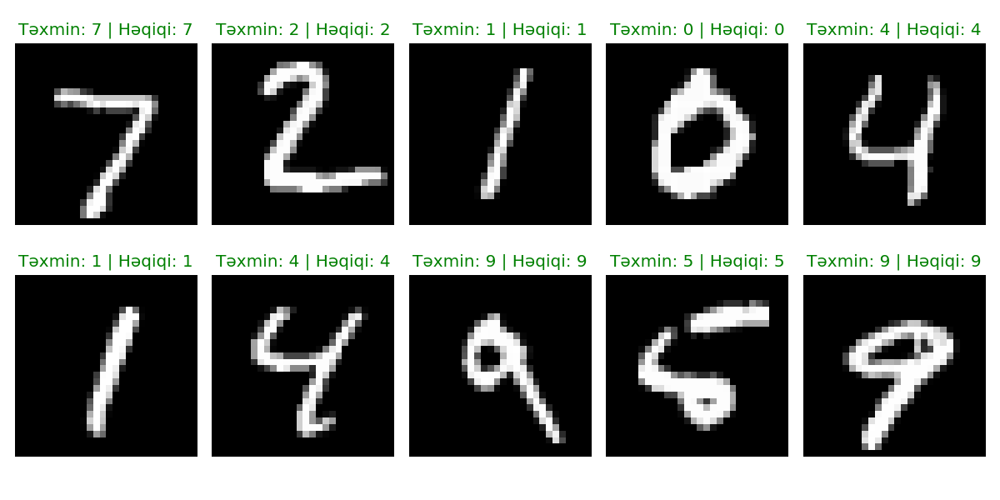

# MNIST CNN (PyTorch)

A learning project where I train a Convolutional Neural Network
on the MNIST dataset using PyTorch.

## Features
- 3 convolutional layers with BatchNorm and Dropout
- AdamW optimizer with LinearLR scheduler
- Train / validation loop with progress bars (tqdm)
- Logging to console and file
- Prediction visualization with matplotlib

## Setup
```bash
pip install torch torchvision tqdm matplotlib numpy
python train.py
```

## What I learned
- How a training loop works in PyTorch
- Why BatchNorm and Dropout are used
- How to log and visualize results

## Results
- Test accuracy: 99.16% (early stopping at epoch 13, best epoch 10, CPU)
- Test loss: 0.0241


